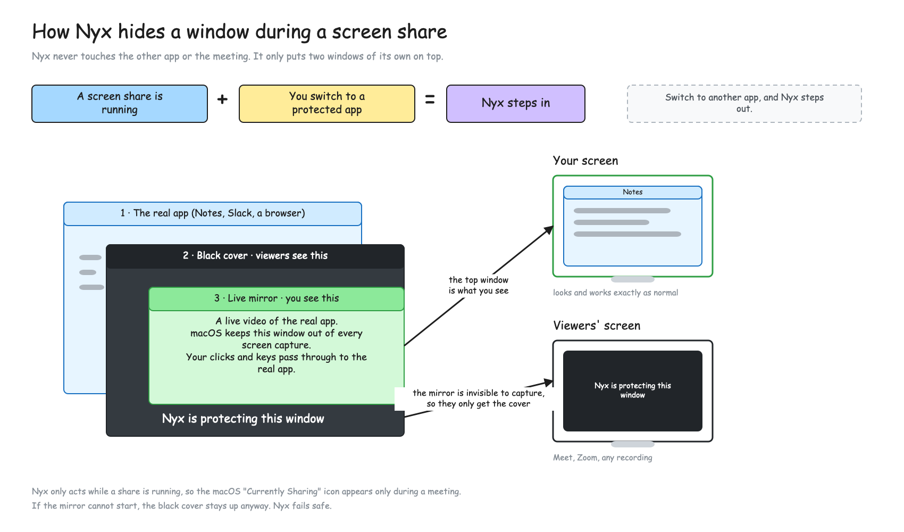

<div align="center">


# Nyx

**Share your screen, not everything on it.**

Nyx blacks out the apps and sites you choose whenever something is capturing your screen.<br>
You keep using them normally — viewers see a placeholder.

One codebase for macOS, Windows and Linux, built with Tauri.

</div>

---

## How it works

Nyx never touches the other app or the meeting. It puts two windows of its own on top — a black cover that capture software sees, and a live mirror that only you see. Your clicks and keys pass through to the real app underneath.

<div align="center">

</div>

| | macOS | Windows | Linux (X11) |
|---|---|---|---|
| Knows a capture started | WindowServer's screen-watcher flag | the capture consent store | no signal: always covers |
| Cover viewers see | above the app's windows, menus included | above the app's windows, menus included | above the app's windows |
| Mirror only you see | ScreenCaptureKit, `sharingType = none` | Windows Graphics Capture, `WDA_EXCLUDEFROMCAPTURE` | none: X11 cannot hide a window from capture |
| Site rules | host from the address bar (Accessibility) | brand name in the window title | brand name in the window title |
| Status | built and tested | written, compile-checked, **not yet run** | written, compile-checked, **not yet run** |

On Linux you see the cover too, so protected apps are unusable while they are in front. Wayland sessions are not supported: Nyx cannot see or cover other windows there, and says so.

---

## Use

- Nyx lives in the **tray** (owl icon). The dashboard opens on first launch, or from the tray.
- Add apps from the dashboard picker, by pressing <kbd>Ctrl</kbd><kbd>Shift</kbd><kbd>L</kbd> (<kbd>⌃</kbd><kbd>⇧</kbd><kbd>L</kbd> on a Mac) while using one, or from the tray's first item.
- List a host such as `youtube.com` and the browser is covered whenever a matching page is your front tab. Subdomains count (`m.youtube.com`), look-alikes do not (`notyoutube.com`).
- If the mirror cannot start, Nyx fails closed: the cover stays up and the tray dot turns red.
- The protected list is `protected.json` in `~/Library/Application Support/Nyx` (macOS), `%APPDATA%\Nyx` (Windows) or `~/.config/Nyx` (Linux). The macOS file is the one the Swift version of Nyx wrote, so an existing list carries over.

macOS asks for **Screen Recording** on first launch, and site rules need **Accessibility**. Windows and Linux ask for nothing.

---

## Build

Needs [Rust](https://rustup.rs) and [Bun](https://bun.sh), plus the [Tauri prerequisites](https://tauri.app/start/prerequisites/) for your OS.

```sh
bun install
bun tauri dev        # run with the dashboard hot-reloading
bun run test         # the Rust test suite
bun run mac-app      # macOS: build Nyx.app (NYX_UNIVERSAL=1 for both architectures)
bun tauri build      # Windows or Linux: build that OS's installers on that OS
```

<details>
<summary><b>Signing for local development on macOS</b></summary>

<br>

Run `./scripts/make-dev-cert.sh` once to create a self-signed "Nyx Dev" signing identity; `bun run mac-app` picks it up automatically and the Screen Recording grant then survives rebuilds. Without it the bundle is ad-hoc signed and macOS invalidates the grant after every rebuild (fix a stale grant with `tccutil reset ScreenCapture tech.unravel.nyx`).

The certificate is not installed as a trusted root, but it still grants Screen Recording to anything signed with it under `tech.unravel.nyx`, so remove it when you are done developing:

```sh
./scripts/remove-dev-cert.sh
```

</details>

<details>
<summary><b>Layout</b></summary>

<br>

- `src/` — the dashboard, in Svelte.
- `src-tauri/src/` — the platform-neutral core: site rules (`site.rs`), the protected list (`store.rs`), the engine that decides when to cover (`engine.rs`), the tray and the dashboard's commands.
- `src-tauri/src/platform/{macos,windows,linux}/` — everything that touches other apps' windows, the same functions on each OS.
- `site/` — the website: one static page, deploy the folder as is. The app build never touches it.

</details>

---

<div align="center">

<sub>Built by</sub><br>


</div>
