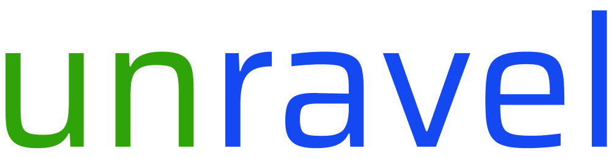

<div align="center">


# Nyx

**Share your screen, not everything on it.**

Nyx blacks out the apps and sites you choose whenever something is capturing your screen.<br>
You keep using them normally — viewers see a placeholder.

One codebase for macOS, Windows and Linux, built with Tauri.

</div>

---

## How it works

Nyx never touches the other app or the meeting. It puts two windows of its own on top — a black cover that capture software sees, and a live mirror that only you see. Your clicks and keys pass through to the real app underneath.

<div align="center">

</div>

| | macOS | Windows | Linux (X11) |
|---|---|---|---|
| Knows a capture started | WindowServer's screen-watcher flag | the capture consent store | no signal: always covers |
| Cover viewers see | above the app's windows, menus included | above the app's windows, menus included | above the app's windows |
| Mirror only you see | ScreenCaptureKit, `sharingType = none` | Windows Graphics Capture, `WDA_EXCLUDEFROMCAPTURE` | none: X11 cannot hide a window from capture |
| Site rules | host from the address bar (Accessibility) | brand name in the window title | brand name in the window title |
| Status | built and tested | written, compile-checked, **not yet run** | written, compile-checked, **not yet run** |

On Linux you see the cover too, so protected apps are unusable while they are in front. Wayland sessions are not supported: Nyx cannot see or cover other windows there, and says so.

---

## Install

macOS, in one line. It verifies the download's checksum and skips the Gatekeeper prompt:

```sh
curl -fsSL https://raw.githubusercontent.com/aristocrat71/nyx-app/main/install.sh | bash
```

Or download [Nyx.dmg](https://github.com/aristocrat71/nyx-app/releases/latest/download/Nyx.dmg). Nyx is not notarized yet, so the first launch is blocked: click **Done**, then **System Settings › Privacy & Security › Open Anyway**. Windows and Linux builds are not released yet.

---

## Use

- Nyx lives in the **tray** (owl icon). The dashboard opens on first launch, or from the tray.
- Add apps from the dashboard picker, by pressing <kbd>Ctrl</kbd><kbd>Shift</kbd><kbd>L</kbd> (<kbd>⌃</kbd><kbd>⇧</kbd><kbd>L</kbd> on a Mac) while using one, or from the tray's first item.
- List a host such as `youtube.com` and the browser is covered whenever a matching page is your front tab. Subdomains count (`m.youtube.com`), look-alikes do not (`notyoutube.com`).
- If the mirror cannot start, Nyx fails closed: the cover stays up and the tray dot turns red.
- The protected list is `protected.json` in `~/Library/Application Support/Nyx` (macOS), `%APPDATA%\Nyx` (Windows) or `~/.config/Nyx` (Linux). The macOS file is the one the Swift version of Nyx wrote, so an existing list carries over.

macOS asks for **Screen Recording** on first launch, and site rules need **Accessibility**. Windows and Linux ask for nothing.

---

## Releasing

1. Write the changes under `## [Unreleased]` in `CHANGELOG.md` as you merge. That section becomes the release notes.
2. On an up-to-date `main`, run `./scripts/release.sh 0.1.1`. It sets the version in `package.json`, `tauri.conf.json`, `Cargo.toml` and `Cargo.lock`, dates the changelog section, commits and tags `nyx-v0.1.1`.
3. `git push origin main nyx-v0.1.1`. The `release` workflow refuses a tag that is off `main`, disagrees with the version files or has no changelog section, then builds and publishes the GitHub Release with a `.sha256` and a provenance attestation per installer.

Only macOS is released for now, to save Actions minutes: add `ubuntu-22.04` and `windows-latest` to the `platform` list in `.github/workflows/release.yml` to ship those too. To try a branch on a real machine without releasing, run the `test-build` workflow by hand; it uploads unsigned installers for all three as run artifacts.

One-time setup: under **Settings › Environments**, create `release`, add yourself as a required reviewer, and allow deployments from tags matching `nyx-v*` (a tag never satisfies "protected branches only").

---

<div align="center">

<sub>Built by</sub><br>


</div>
